# Panduan Kerja Proyek — Hx Mobile (`Stadium DSP` / `nafta121/helxmoblie`)

> **Dokumen Acuan Kerja Utama (*Single Source of Truth*)**  
> **Proyek:** Hx Mobile (`com.cleanroom.stadiumdsp`) — Prosesor Multi-Efek & Pemodel Ampli Gitar/Bass Android *100% Clean-Room* (C++20 / ARM64 NEON + Oboe MMAP + Jetpack Compose) dengan paritas arsitektur, kualitas suara, & alur kerja *Line 6 Helix Stadium Native v1.4* dan *LIVE Performance*.  
> **Repositori Target:** `https://github.com/nafta121/helxmoblie`  
> **Terakhir Diperbarui:** 20 November 2026

---

## 1. Ringkasan Konteks Sesi & Status Kritis Repositori

### 1.1 Rekonsiliasi Konteks Sesi Sebelumnya

- **Referensi Pengguna:** `Conversation ID: 0f8bc195-d6ad-4551-829b-f15340a14266`.
- **Hasil Pelacakan Persisten di Lingkungan Cloud:** Direktori *brain* bernama persis `0f8bc195-d6ad-4551-829b-f15340a14266` tidak terpasang di `/home/antigravity/.gemini/jetski/brain/` (karena perbedaan ID antarmuka dengan ID direktori internal *remote agent*, atau transkrip sesi tidak ikut ter-mount). Namun, seluruh artefak riset, cetak biru DSP, katalog model, audit kesenjangan fitur, rancangan UI/UX, prototipe interaktif HTML, 4 gambar desain, log verifikasi 18 suite DSP, serta tautan APK untuk proyek **Hx Mobile (`stadium_android_dsp` / `helxmoblie`)** tersimpan utuh pada direktori *brain*:
  - `/home/antigravity/.gemini/jetski/brain/v1/default/jetski_remote_agents_3p/21594415-baf9-4832-a17a-34ac1bc16580/` (aktivitas 16–20 November 2026, terakhir pukul `00:07 UTC` 20 Nov 2026).

### 1.2 Peringatan Kritis: Status Kode Sumber & VM Ephemeral

| Aset Proyek | Status Saat Ini | Lokasi / Keterangan |
| :--- | :--- | :--- |
| **Repositori GitHub `nafta121/helxmoblie`** | **Kosong (0 commit)** | Baru dibuat (`2026-11-20T21:50:28Z`); belum berisi kode sumber dari sesi sebelumnya. |
| **Kode Sumber `/home/antigravity/stadium_android_dsp`** | **Hilang bersama VM Ephemeral lama** | Lingkungan VM sebelumnya bersifat *ephemeral*; folder kerja lokal tidak ikut berpindah ke VM baru karena belum sempat di-push ke GitHub. |
| **Seluruh Laporan Riset, Cetak Biru DSP, Katalog 605 Model, Audit 23 Gap, Rencana UI/UX, Prototipe HTML, & 4 Mockup** | **Tersimpan Persisten (100% Utuh)** | `/home/antigravity/.gemini/jetski/brain/v1/default/jetski_remote_agents_3p/21594415-baf9-4832-a17a-34ac1bc16580/` |
| **APK Terkompilasi v0.1.0 (`arm64-v8a` + `x86_64`)** | **Tersimpan Persisten di Google Drive** | `Hx-Mobile-StadiumDSP-v0.1.0-debug.apk` (27,06 MB) di folder Drive [`Hx Mobile`](https://drive.google.com/drive/folders/1Ip3G1ytd-w4fPXmM-IWJcBqsOLTRBhHe) (`ID: 16fkTw3yr78ZLbH6APdaS3XSeDK7wmANw`). |
| **Log Verifikasi Terakhir (Test 1–18)** | **Tersimpan Persisten** | `task-1847.log`, `task-2014.log`, `task-2015.log` di folder `.system_generated/tasks/` sesi `21594415-...`. |

### 1.3 Keputusan Jalur Lanjutan (Sebelum Menulis Kode Baru)

1. **Jalur A — Jika Anda Memiliki Backup Lokal Kode `stadium_android_dsp`:**  
   Unggah/push kode tersebut ke repositori `nafta121/helxmoblie`, lalu kita langsung melanjutkan eksekusi dari **Fase 3 (Paket Fondasi 3: `8 Snapshots`, `Presets/Setlists`, `5-Zone Focus Bank`, `Undo/Redo`)** menuju **Fase 4** dan **Fase 5 (UI/UX Modular)**.
2. **Jalur B — Jika Tidak Ada Backup Sumber Kode (Clean-Room Rebuild *Commit-First*):**  
   Kita membangun ulang kode sumber `dsp_core/` + `app/` + `tests/` + `tools/` langsung di repositori `nafta121/helxmoblie` secara modular dan terstruktur menggunakan seluruh spesifikasi matematis, rumus MNA, katalog model, dan cetak biru yang sudah terdokumentasi tuntas — **dengan disiplin wajib commit & push ke GitHub pada setiap milestone** agar kode tidak pernah hilang lagi.

---

## 2. Rekam Jejak Progres Sesi Sebelumnya (Tahap 1–14 + Awal Fondasi)

Berikut adalah garis waktu pencapaian yang telah diselesaikan pada sesi sebelumnya:

| Tahap | Cakupan Pekerjaan | Hasil / Bukti Verifikasi |
| :--- | :--- | :--- |
| **Tahap 1–2** | Investigasi REA *Relic v0.4.7* & bedah DSP mendalam `RF-E` (SSL 4000 E-Series). | `laporan_bedah_relic_0_4_7.md`, `laporan_dsp_rfe_0_4_7.md` |
| **Tahap 3** | Investigasi statis REA *Helix Stadium Native v1.3.3* (tanpa menyentuh DRM/lisensi) & perancangan cetak biru porting Android *Clean-Room*. | `laporan_rea_helix_stadium_android.md` |
| **Tahap 4** | Implementasi prototipe inti C++20 `dsp_core` (Sub-Blok 16 sampel, `FPCR.FZ`, Agoura WDF/NR + ADAA1 + 2x/4x Polyphase + `Z_cab`, Dual Cab IR `2.048-tap` FP32 zero-latency, Neural Clone `Batch-16` `.nam`/`.aidax`) + APK Android Oboe. | Test 1–5 lulus; APK `arm64-v8a` berhasil dibangun |
| **Tahap 5–7** | Ekstraksi katalog lengkap **605 model** (761 entri DSP internal) di 18 kategori, bedah arsitektur dual-graph `l6spe` & oversampler elliptic, serta investigasi **7 Pilar Presisi Hardware Dunia Nyata**. | `katalog_model_helix_stadium_v1_3_3.md`, `laporan_arsitektur_dsp_waveform_helix.md`, `laporan_rea_presisi_hardware_helix.md` |
| **Tahap 8** | Implementasi 6 modul presisi hardware (`Auto-Z` RLC, `pot_tapers`, mikro-fisika tabung/PSU `Victoria/T11`, `Z PrePost` + `16-tap CabZFir`, morphing spektral IR `128`-sampel + 12 Mikrofon + `Auto Air Delay`, kalibrasi `dBu` Neural Clone) + 5 kernel efek analog pertama + solver MNA Python. | Test 6–10 lulus; MNA Python 1–4 lulus |
| **Tahap 9** | Penurunan analitik orde-4 **R.T. James (1949)** & perluasan `amp_recipe_bank.hpp` ke **30 resep skema ampli gitar & bass** (20 Agoura Guitar, 5 HX Boutique/Clean, 5 Agoura/HX Bass) di atas 8 topologi *tone stack* fisik. | Test 11 lulus; MNA 5 lulus (galat James `0,014–0,027 dB`) |
| **Tahap 10** | Pemilih berkas lokal Android SAF (`OpenDocument`) untuk `.nam` multi-tahap Tone3000, `.aidax` Keras, dan IR `.wav` (`16/24/32 PCM`, `32/64 Float`) dengan *4-Term Blackman-Harris Windowed-Sinc Resampler* ke `48 kHz` `2.048-tap`. | Test 12 lulus (SRC galat `0,0002 dB`); JUnit lulus |
| **Tahap 11** | Ekspansi bank efek: **Pitch/Synth (5)** (WSOLA + BOSS OC-2 CMOS), **Wah/Filter (8)** (`70k/90k` Wah, Mu-Tron III, Obi S&H, 8-Band MuRF), dan **Modulasi/Rotary (10)** (`Uni-Vibe 22k`, Phase 90, CE-1, Trinity 120°, Harmonic Trem, `122 Rotary`). | Test 13 lulus; MNA 6 lulus (`11` blok aktif) |
| **Tahap 12** | Pengujian langsung & debugging APK multi-ABI (`arm64-v8a` + `x86_64`) pada emulator Android 12 (`emulator-5554`): perbaikan `ActivityNotFoundException`, eliminasi ANR `5.002 ms` ke `Dispatchers.IO`, penambahan pembatas DAC kontinu-C¹ `-0,10 dBFS`, telemetri `CLOCK_THREAD_CPUTIME_ID`, dan isolasi rekomposisi Compose. | `AndroidRuntime Errors: 0`, `ANR Count: 0`, `OUT PEAK = -0.1 dB` |
| **Tahap 13** | Perluasan bank **Delay (7)** (`DM-2`, `Cosmos Echo RE-201` 3-Head + Spring, `Adriatic MN3102`, `EP-3`, `DMM`, `Vintage Digital 12-bit`, `Ducked 2290`) & **Reverb (7)** (`Hall`, `Plate`, `Glitz`, `Searchlights +1 Oct`, `'63 Spring 6G15` 36-tahap *chirp*, `Ganymede`, `Plateaux`). | Test 14 lulus; MNA 7 lulus (dispersi pegas `+8,43 ms`) |
| **Tahap 14** | Perluasan bank **Drive / Overdrive / Fuzz / Boost (12)** termasuk penurunan MNA 3-simpul *Big Muff Pi* & antiturunan *Shockley* `1N34A` Ge (`Minotaur/Klon`, `Teemah!/Timmy`, `Heir Apparent/PoT`, `Compulsive Drive/OCD`, `'73 Ram's Head`, `'69 Triangle`, `Kinky Boost`, `Deranged Master 10k`, `Obsidian 7000`, `TS808`, `RAT`, `Fuzz Face`). | Test 15 lulus; MNA 8 lulus; 14/14 JUnit; **APK v0.1.0 (27,06 MB) diunggah ke Google Drive** |
| **Riset UI/UX & Audit Gap** | Riset mendalam *Helix Stadium Native v1.4* & *Live Touchscreen*, pembuatan 4 gambar desain postur, prototipe HTML interaktif, cetak biru UI/UX adaptif 5-postur, serta **Audit 23 Kesenjangan Fitur** (6 domain, 4 Paket Fondasi) sebelum merombak UI. | `rencana_ui_ux_helix_stadium_mobile.md`, `prototipe_interaktif_ui_hx_mobile.html`, `audit_gap_fitur_sebelum_ui_ux.md` |
| **Eksekusi Awal Fondasi 1 & 2 (20 Nov 00:06 UTC)** | Sempat diimplementasikan di VM lama: Test 16 (`Chromatic Tuner`, `Global BPM Sync`, `Volume/Pan`, `Stereo Looper`, `EQ/IR Spectrum`), Test 17 (`Dynamic Block Routing`, `Split/Merge 1A/1B`, `MasterMute`, `Live Telemetry`), dan Test 18 (`Preset Clip Audition Player`, `12 Factory Guitar/Bass Cabs`). | `task-2014.log`: **18/18 Suite C++20 LULUS** (`13,27 us` / 16 sampel = `4,0%` RT budget); terhenti saat instalasi ulang SDK di `task-2015.log` |

---

## 3. Prinsip & Batasan Rekayasa Tak Ternegosiasikan (*Engineering Invariants*)

Seluruh kontribusi kode di repositori `nafta121/helxmoblie` wajib mematuhi aturan berikut tanpa pengecualian:

### 3.1 Kepatuhan *100% Clean-Room* (DSP & Visual)
1. **0 Byte Salinan Aset/Biner Pihak Ketiga:** Dilarang menyalin tabel `.rdata`, firmware, IR berlisensi, ikon bitmap, atau logo merek dagang dari perangkat lunak pihak ketiga; modul DRM/lisensi sepenuhnya *out-of-scope*.
2. **Pemodelan Berbasis Hukum Fisika:** Seluruh kernel DSP diturunkan dari persamaan rangkaian fisik (*Kirchhoff Nodal Admittance / MNA*, *Matched Pole-Zero*, *First-Order ADAA*, *Newton-Raphson* teredam, *Cytomic TPT SVF*, *Tustin Bilinear*, *Linkwitz-Riley LR2*, *Bridged-T Helical Allpass*, *WSOLA Phase-Locked*).
3. **Grafis Prosedural:** Seluruh ikon blok, *Focus Lens*, penampang konus speaker 3D/2D, meter VU/GR, dan *Virtual OLED Scribble Strip* digambar secara prosedural dengan Jetpack Compose `Canvas` / `ImageVector` / AGSL.

### 3.2 Aturan Suci Utas Audio Real-Time (`onAudioReady`)
1. **Laju Sampel & Kuantum Tetap:** Internal dikunci pada **`48.000 Hz` FP32**, memotong setiap *burst* AAudio menjadi sub-blok tetap **`16` sampel (`64 byte` = 1 baris L1 Cache ARM64, control-rate `3.000 Hz`)** dengan *zero framing latency* untuk burst `48 / 64 / 96 / 128 / 192` frame.
2. **Zero-Allocation & Lock-Free Mutlak:** Di dalam utas audio C++20 **dilarang keras** melakukan `malloc`/`new`/`free`, `std::mutex`, panggilan JNI ke Kotlin, I/O berkas/SQLite, atau `logcat`.
3. **Komunikasi & Pergantian Tanpa Klik:** Parameter & peristiwa dikirim lewat *Wait-Free SPSC Ring Buffer*; pergantian grafik preset memakai *atomic pointer swap* (RCU) dengan *raised-cosine crossfade* `64–128` sampel; pergantian **8 Snapshots** menginterpolasi parameter halus (`5–10 ms`) langsung pada grafik aktif **tanpa memanggil `ResetAll()`** agar ekor Delay/Reverb terus mengalun (*true spillover trails*).
4. **Proteksi Perangkat Keras ARM64:** Setel bit **Flush-to-Zero (`FPCR.FZ`, bit 24)** sekali saat utas audio dimulai; manfaatkan NEON FMA (`vfmaq_f32`) dan flag kompilasi `-O3 -march=armv8.2-a+fp16+dotprod`.
5. **I/O Ultra-Low Latency & ADPF:** Gunakan **Google Oboe `1.9.3`** (`SharingMode::Exclusive`, `PerformanceMode::LowLatency`, `InputPreset::Unprocessed`, *fallback* `SampleRateConversionQuality::Medium` untuk HAL `44,1 kHz`), serta daftarkan `gettid()` ke **ADPF (`APerformanceHintManager`)** untuk mengunci eksekusi pada *Prime/Big Core*.
6. **Inferensi Neural di CPU NEON (Bukan NPU/GPU/NNAPI):** Eksekusi `.nam` (WaveNet) & `.aidax` (GRU) wajib menggunakan **mikro-batch `16` sampel pada CPU ARM64 NEON** (latensi FIFO `0` sampel). Hindari NNAPI/GPU/NPU karena *overhead* IPC driver (`1,5–8,0 ms`) menghancurkan anggaran burst `1,0 ms`.
7. **Pengaman DAC Kontinu-C¹:** Tahap akhir wajib memasang pembatas lunak kontinu-C¹ pada **`-0,10 dBFS`** agar keluaran tidak pernah mengalami *hard digital clipping*.

### 3.3 Kepatuhan Android Adaptif & Keandalan Panggung (*Stage-Proof*)
1. **SDK & ABI:** `minSdk = 31`, `compileSdk = 35`, `targetSdk = 35`, multi-ABI **`arm64-v8a`** (perangkat fisik) + **`x86_64`** (emulator/CI).
2. **Tanpa Kunci Orientasi / Config Suppression:** Dilarang memasang `android:screenOrientation` atau `android:configChanges` pada `AndroidManifest.xml`.
3. **Kontinuitas Audio `0 ms` Saat Rotasi & Layar Mati:** Siklus hidup mesin Oboe dikelola oleh **`StadiumAudioForegroundService`** (`microphone|mediaPlayback`) + controller singleton; `Activity.onDestroy()` saat `isChangingConfigurations == true` **tidak boleh** memanggil `nativeStopAudio()`.
4. **Ergonomi Sentuh Panggung:**
   - Target sentuh minimum `48dp` pada Studio Edit dan **`80dp–96dp`** pada mode *LIVE Play*.
   - Tombol *Footswitch* panggung wajib terpicu instan pada **`PointerEventPass.Initial`** (`awaitFirstDown` / *touch-down*), **bukan** `detectTapGestures(onDoubleTap = ...)` yang menahan respons `300 ms`.
   - `Stage Lock` menolak geseran slider/XY/reorder tidak sengaja, tetapi tetap meloloskan `Snapshots 1–8`, `Stomps`, `TAP Tempo`, `EXP 1/2`, `Tuner`, dan tombol darurat **`MUTE ALL`** (`< 1 frame`).
5. **Disiplin Persistensi Git (Wajib Mulai Sesi Ini):**
   - Setiap selesai satu sub-paket/task yang lulus verifikasi, segera **commit ke feature branch / push ke `nafta121/helxmoblie`** agar tidak ada pekerjaan yang pernah hilang jika VM cloud direset.

---

## 4. Arsitektur Teknis & Peta Modul Target

### 4.1 Diagram Aliran Sinyal DSP (`48 kHz`, Sub-Blok 16 Sampel, Jalur Dinamis + Paralel 1A/1B)

```mermaid
flowchart LR
    IN["Input Gitar / Bass 48 kHz + Preset Clip DI"] --> TRIM["Input Trim + Auto-Z RLC 10k-1M"]
    TRIM --> TUNER["Chromatic Tuner YIN + Gate"]
    TUNER --> SPLIT["Dynamic Slot Router + Split Y / A-B / Crossover"]

    subgraph PATH1A["Path 1A - Rantai Utama"]
        PITCH["Pitch/Synth - 5 Model"] --> COMP["Opto/VCA Comp - 2 Model"]
        COMP --> WAH["Wah/Filter - 8 Model"]
        WAH --> DRV["Drive/Fuzz/Boost - 12 Model"]
        DRV --> MODPRE["Modulation Pre - 10 Model"]
        MODPRE --> AMP["30-Recipe Agoura Tube Amp + Neural Clone"]
        AMP --> CAB["Dual 2048-Tap Cab IR + 12 Factory Cabs + 12 Mics"]
        CAB -. "Reactive Z_cab + 16-Tap CabZFir" .-> AMP
    end

    subgraph PATH1B["Path 1B - Cabang Paralel Opsional"]
        PAR["Parallel FX / Dry Blend / Dual Amp-Cab"]
    end

    SPLIT --> PITCH
    SPLIT --> PAR
    CAB --> MERGE["Merge Mixer - Level/Pan/Phase Invert"]
    PAR --> MERGE

    MERGE --> EQ["Studio EQ - Parametric / 10-Band / Tilt"]
    EQ --> VOL["Volume/Pan Block - EXP 2"]
    VOL --> MODPOST["True Stereo Modulation"]
    MODPOST --> DLY["Stereo Delay Bank - 7 Model"]
    DLY --> REV["Dynamic FDN & Spring Reverb - 7 Model"]
    REV --> LOOP["Stereo Looper 30-60s"]
    LOOP --> OUT["Output Trim/Pan + MasterMute 5ms + C1 -0.10 dBFS"]
```



### 4.2 Inventaris 73+ Model Sirkuit Hardware Presisi (Cakupan Katalog Inti)

| Kategori | Jumlah | Rincian Model & Teknik Inti Clean-Room |
| :--- | :---: | :--- |
| **Ampli Gitar & Bass (`amp_recipe_bank.hpp`)** | **30** | 20 Agoura Guitar + 5 HX Boutique/Clean + 5 Agoura/HX Bass; 8 topologi *tone stack* (FMV orde-3 & R.T. James orde-4), 5 sub-sirkuit khusus (`Cali 2C+` 5-Band GEQ, `5F1` SE Class-A, `VH4` Deep, dll.), mikro-fisika `Victoria/T11` (`31%` duty ripple `100/120 Hz`, `ClassBGain`, `HalfWaveCathodeBypass`, `GridBiasExcursion`), `Stock` vs `Hype`, dan kopling reaktif `Z_cab` (`Z PrePost` + `16-tap CabZFir`). |
| **Drive / Overdrive / Fuzz / Boost (`drive_fuzz_kernel.hpp`)** | **12** | `Scream 808` (`230k`), `Vermin Dist` (`LM308` slew), `Arbitrator Fuzz` (`10k` AC128), `Minotaur` (Klon `+18V/-9V` + `1N34A` Ge `ADAA1`), `Teemah!` (Timmy transparan `0,002 dB`), `Heir Apparent` (PoT 3-mode), `Compulsive Drive` (OCD `HP/LP` + MOSFET/Ge), `Bighorn Fuzz` ('73 Ram's Head `136k` 4-stage + MNA 3-simpul), `Triangle Fuzz` ('69 V1 `136k`), `Kinky Boost` (EP-3 `+18V`), `Deranged Master` (`10k` OC44), `Obsidian 7000` (Darkglass B7K CMOS). |
| **Modulasi & Rotary (`modulation_bank.hpp`)** | **10** | `CE-1 Chorus` (`230k`), `Trinity 120° Chorus`, `VB-2 Vibrato`, `Script Phase 90` (4-stage allpass `38,7 dB` notch), `Ubiquitous Vibe` (`22k` photocell), `Flanger 117`, `Optical Tremolo`, `Bias Tremolo`, `Brownface Harmonic Tremolo` (anti-phase `corr = -0,99`), `122 Rotary` (Leslie horn/drum Doppler). |
| **Wah & Filter (`wah_parametric_eq.hpp`)** | **8** | `Fassel 310` (`90k`), `Throaty Clyde` (`70k`), `UK 846`, `Teardrop`, `Mutant Filter Up`, `Tron Down` (Mu-Tron III Vactrol), `Obi Wah` (`230k` S&H), `8-Band MuRF` step filter. |
| **Delay (`tape_bbd_delay.hpp`)** | **7** | `Bucket Brigade` (DM-2 `MN3005` + `NE570`), `Cosmos Echo` (RE-201 3-Head `0,382/0,685/1,0` + bitmask `1..7` + Spring), `Adriatic Delay` (overclocked `MN3102`), `Transistor Tape` (EP-3 JFET + Chua LFO), `Elephant Man` (DMM dual `MN3005`), `Vintage Digital` (`12-bit` µ-law), `Ducked Delay` (TC 2290). |
| **Reverb (`dynamic_fdn_reverb.hpp`)** | **7** | `Dynamic Hall` (`8x8` Unitary Walsh-Hadamard), `Dynamic Plate`, `Glitz` (bloom + tank chorus), `Searchlights` (FDN + WSOLA `+1 Oct` shimmer), `'63 Spring` (`6G15` `6K6GT` + `36`-stage helical chirp dispersion), `Ganymede`, `Plateaux` (dual `+12st`/`+7st` shimmer). |
| **Pitch & Synth (`pitch_synth_kernel.hpp`)** | **5** | `Pitch Wham`, `Poly Capo`, `Twin Harmony` (WSOLA phase-locked), `Boctaver` (BOSS OC-2 CMOS `÷2/÷4`), `12-String`. |
| **Dynamics & EQ** | **3+** | `Horizon Precision Gate` (`850 Hz` sidechain HPF + hysteresis), `Studio Opto Comp` (LA-2A `T4B` dual-release) & `VCA Red Squeeze`, `Studio EQ` (`Parametric` anti-cramp + `10-Band Graphic` + `Tilt EQ`). |
| **Cab IR & Neural Clone** | **12 Cabs + 12 Mics + Unlimited SAF** | `Dual 2.048-Tap FP32 Zero-Latency Partitioned FFT`, `128-sample` spectral morphing bebas klik, `Auto Air Delay`, `12 Factory Guitar/Bass Cabs` (`8x10 SVT`, `4x12 V30`, `1x8 Tweed`, dll.), `12 Studio Mics`, serta `Batch-16 Neural Clone` (`.nam` WaveNet & `.aidax` GRU + kalibrasi `dBu` + SAF `.wav` Sinc SRC). |

### 4.3 Struktur Direktori Target Repositori (`nafta121/helxmoblie`)

```text
helxmoblie/
├── docs/
│   └── PANDUAN_KERJA.md                       # Dokumen acuan kerja utama ini
├── dsp_core/
│   ├── CMakeLists.txt
│   ├── include/stadium_dsp/
│   │   ├── lockfree_spsc.hpp                  # SPSC ring buffer & RtTelemetrySnapshot (60 Hz)
│   │   ├── polyphase_oversampler.hpp          # Elliptic allpass polyphase 2x/4x/8x
│   │   ├── biquad_anticramp.hpp               # Magnitude-matched biquad & ReactiveCabImpedance + 16-tap CabZFir
│   │   ├── guitar_input_z.hpp                 # Auto-Z RLC pickup loading (10k..1M Ohm)
│   │   ├── pot_tapers.hpp                     # Taper 10A/15A/Rev-Log C/W & coupled Bright-Cap
│   │   ├── oscillators_and_lfo.hpp            # Parabolic sine NEON, TriSawLFO, 3D Chua Chaotic LFO
│   │   ├── amp_precision_blocks.hpp           # Victoria/T11 micro-physics (ripple 31%, ClassB, bypass cap, grid bias)
│   │   ├── amp_recipe_bank.hpp                # 30 resep skema ampli (FMV orde-3 & James orde-4)
│   │   ├── agoura_tube_amp.hpp                # Agoura solver NR/ADAA1 + Hype + Z_cab + Focus XY
│   │   ├── neural_clone_engine.hpp            # Batch-16 NEON WaveNet (.nam) & GRU (.aidax) + dBu cal
│   │   ├── dual_cab_convolver.hpp             # Dual 2048-tap FP32 zero-latency FFT + 128-smp morph + 12 Mics + 12 Factory Cabs
│   │   ├── drive_fuzz_kernel.hpp              # 12 pedal Drive/Fuzz/Boost + Big Muff MNA + 1N34A ADAA1
│   │   ├── dynamics_gate_comp.hpp             # Horizon Gate + LA-2A T4B Opto / VCA Comp + GR telemetry
│   │   ├── wah_parametric_eq.hpp              # 8 Wah/Filter + Parametric / 10-Band Graphic / Tilt EQ + curve eval
│   │   ├── modulation_bank.hpp                # 10 efek Modulasi & Leslie 122 Rotary
│   │   ├── pitch_synth_kernel.hpp             # 5 efek Pitch WSOLA & OC-2 CMOS
│   │   ├── tape_bbd_delay.hpp                 # 7 topologi Delay (RE-201, DM-2, Adriatic, EP-3, DMM, 2290)
│   │   ├── dynamic_fdn_reverb.hpp             # 7 topologi Reverb (Hall, Plate, Glitz, Searchlights, '63 Spring, Plateaux)
│   │   ├── chromatic_tuner.hpp                # YIN differential + parabolic sub-cent tuner (30-1200 Hz, 425-455 Hz ref)
│   │   ├── volume_pan_looper.hpp              # Volume/Pan block + Stereo Looper (30-60s crossfade + Undo)
│   │   ├── tempo_and_routing.hpp              # TempoClock (BPM/Tap/Beat Sync) + Dynamic Slot / Split-Merge 1A/1B
│   │   ├── preset_clip_player.hpp             # DryClipAuditionPlayer (multi-gaya riff DI + WAV seek/repeat)
│   │   └── signal_chain_processor.hpp         # GuitarRigGraph + StadiumSignalChainProcessor (RCU + 8-Snapshot spillover)
│   └── src/
│       ├── neural_json_loader.cpp             # Parser .nam/.aidax + RIFF WAVE + Blackman-Harris Sinc SRC
│       └── signal_chain_processor.cpp         # Pemrosesan sub-blok 16 sampel + SPSC dispatch + C1 limiter
├── tests/
│   └── test_dsp_suite.cpp                     # Suite verifikasi host C++20 (Test 1..18+)
├── tools/
│   └── verify_hardware_precision.py           # Solver referensi float64 MNA & dispersi (MNA Check 1..8+)
└── app/
    ├── build.gradle.kts                       # SDK 35, minSdk 31, Compose Adaptive, Navigation 3, Serialization
    └── src/
        ├── main/
        │   ├── AndroidManifest.xml            # Tanpa screenOrientation/configChanges; pro audio, USB, MIDI, ForegroundService
        │   ├── cpp/
        │   │   ├── CMakeLists.txt             # Multi-ABI arm64-v8a + x86_64, Oboe 1.9.3
        │   │   ├── OboeGuitarEngine.hpp/.cpp  # AAudio MMAP Exclusive, ADPF, CLOCK_THREAD_CPUTIME_ID, DryClipPlayer
        │   │   └── NativeDspBridge.cpp        # JNI zero-GC telemetry, SPSC commands, SAF byte buffers
        │   └── java/com/cleanroom/stadiumdsp/
        │       ├── MainActivity.kt            # Single-Activity Adaptive host (tanpa stop audio saat rotasi)
        │       ├── NativeDspBridge.kt         # Deklarasi JNI
        │       ├── audio/StadiumAudioForegroundService.kt  # Layanan panggung 0-ms rotasi & Keep-Screen-On
        │       ├── catalog/                   # AmpModelCatalog.kt, FxModelCatalog.kt, FactoryCabCatalog.kt, ParameterSchemaRegistry.kt
        │       ├── importer/ExternalRigFileImporter.kt     # SAF OpenDocument + fallback scoped folder
        │       ├── preset/                    # StadiumPresetModels.kt, PresetRepository.kt, SnapshotManager.kt, FocusZoneBank.kt, RigHistoryManager.kt
        │       ├── midi/                      # StadiumMidiService.kt, ControllerAssignmentEngine.kt, LiveFootswitchMatrix.kt
        │       └── ui/
        │           ├── theme/StadiumDesignTokens.kt
        │           ├── state/StadiumRigViewModel.kt
        │           ├── components/            # StadiumTopInstanceBar, SignalFlowCanvas, PolymorphicFocusView, ModelBrowserAndInspector
        │           ├── live/                  # LivePlayScreen, StageTunerOverlay, ShowcasePlayerBar
        │           ├── preview/StadiumFormFactorPreviews.kt
        │           └── StadiumRigScreen.kt    # Orkestrator 5-Postur Adaptif (NavigationSuiteScaffold + Nav 3)
        └── test/java/com/cleanroom/stadiumdsp/ # Suite JUnit lengkap (Importer, Catalog, Snapshot/Focus, Routing, Cab/EQ, MIDI)
```

---

## 5. Spesifikasi Ringkas UI/UX Paritas *Helix Stadium Native v1.4* & *LIVE*

### 5.1 Kode Warna Resmi 11 Kategori Blok (di atas Kanvas Gelap `#000000` / `#0D0D0D` / `#141414`)

| Kategori | Hex Resmi | Kategori | Hex Resmi |
| :--- | :---: | :--- | :---: |
| **Amp / Preamp** | `#FF3C3C` *(Crimson Red)* | **Delay** | `#43FF40` *(Emerald Neon)* |
| **Cab / IR** | `#FF509A` *(Hot Rose-Pink)* | **Reverb** | `#FF6828` *(Deep Coral)* |
| **Distortion** | `#FF9B2D` *(Warm Amber)* | **Pitch / Wah** (`EXP 1`) | `#A25DFF` *(Electric Violet)* |
| **Dynamics / EQ** | `#E8D62F` *(Studio Gold)* | **Volume / Pan** (`EXP 2`) | `#0FFFFF` *(Neon Cyan)* |
| **Modulation** | `#00A5FF` *(Electric Azure)* | **I/O, Split, Merge** | `#949494` *(Titanium Gray)* |

### 5.2 Lima Varian Polimorfik *Focus View*
1. **5-Zone XY Morphing Pad** *(Amp, Preamp, Drive, Mod, Delay, Reverb)* — 4 sudut + titik pusat `Origin`, bola *Focus Lens*, meter Input/Output vertikal, bilah kanan (`User/Factory Default`, `Favorites`, `Manage Zones`, `*Based On`).
2. **3D/2D Speaker Cab & Virtual Mic Pad** *(Cab / IR)* — geser mikrofon X (`Center Cap -> Edge -> Rim`) & Y (`1.0" – 12.0"`), sudut `0° / 45°`, tautan `Amp > Cab Link` & `Cab > Cab Link`, plus plot spektrum magnitudo IR `.wav`.
3. **Dynamics Gain Reduction Focus** *(Dynamics)* — batang meter kuning **`GR` (`0..42 dB`)** di sisi kiri kanvas.
4. **Interactive EQ Curve Focus** *(EQ)* — kurva respons `20 Hz – 20 kHz` dengan simpul sentuh (geser X = Freq, Y = Gain, *pinch* = `Q`) + mode `10-Band Graphic` & `Tilt`.
5. **Neural Clone Metadata Focus** *(PROXY / `.nam` / `.aidax`)* — kartu `Brand`, `Product`, `Notes`, kalibrasi `Ref Input dBu`, `Low/High Cut`, dan meter I/O.

### 5.3 Lima Postur Adaptif & Tujuh Pilar *LIVE Performance*
- **5 Postur Adaptif (`derivedMediaQuery` + `WindowSizeClass` + `NavigationSuiteScaffold` + Navigation 3):**
  1. *Tablet Landscape (`>= 840dp`)*: Paritas 1:1 3-panel Studio + Grid Live `2x4`/`2x5` & Pita `EXP` kanan.
  2. *Tablet Portrait (`600–839dp`, mic stand)*: Susunan 4-lapis vertikal (*Header -> Signal Flow -> Hero Focus View -> Tab Inspector/Browser*).
  3. *Phone Landscape (`height < 480dp`)*: Split 2-kolom Focus + Sliders, atau Pedalboard Saku `2x4` penuh.
  4. *Phone Portrait (`< 600dp`, satu ibu jari)*: *Bottom Nav*, pita sinyal geser, area Focus + 4 slider prioritas di *thumb-zone*, Live grid `4x2`.
  5. *Foldable Tabletop (`Posture.Tabletop`)*: Dihitung akurat via `coordinates.windowToLocal` — layar atas tegak (*Signal Flow + Focus/Tuner*), layar bawah datar (*Sliders / Footswitches + EXP*).
- **7 Pilar *LIVE Performance*:**
  1. 6 Mode `Home > Play` (`Combo 4+4`, `Snapshot 1–8`, `Stomp A`, `Stomp B`, `Preset/Setlist`, `Showcase`) + penetapan `MULTIPLE (X)`.
  2. *Quick-Focus Header Strip* (25% atas kartu pedal membuka overlay *Focus Lens*, 75% bawah + cincin LED memicu `ON/BYPASS` instan saat *touch-down*).
  3. `Stage Lock` + Mode Kamera Merah (`Discard Edits`) vs Putih (`Auto-Remember`).
  4. Tombol Darurat **`MUTE ALL`** (`5 ms` *cosine ramp*) & **`Stage Strobe Tuner`** (terbaca jarak 3 meter).
  5. Pita Ekspresi Sentuh **`EXP 1 / EXP 2`** dengan batas `[Min..Max]` & **`Auto-Engage`** (`engage 3%`, `off-delay 200 ms`).
  6. Peralihan **`8 Snapshots`** `0 ms` bebas jeda + *true spillover trails*.
  7. **USB-MIDI & BLE-MIDI (`MidiManager`)** dengan peta CC standar Helix (`CC#69` Snapshot, `CC#49–56` Stomp, `CC#1/2` EXP, `CC#64` Tap, `CC#68` Tuner, `PC` Preset) + **`MIDI Learn` 1-ketuk**.

---

## 6. Peta Jalan Eksekusi Bertahap (Fase 0 s.d. Fase 5)

Prinsip urutan kerja dari audit sesi sebelumnya tetap dipertahankan: **selesaikan fondasi mesin backend/DSP terlebih dahulu (4 Paket Fondasi mencakup 23 GAP) sebelum merakit antarmuka UI/UX akhir**, agar tidak ada satu pun tombol kosmetik kosong di layar.

### Fase 0 — Inisialisasi Repo Git, Setup Environment, & Basis Inti DSP/Android
- [ ] **0.1** Konfirmasi Jalur A (restore backup lokal) atau Jalur B (*clean-room rebuild* langsung di `nafta121/helxmoblie`).
- [ ] **0.2** Siapkan struktur repo Git (`main` + feature branches), `.gitignore` (Android/CMake/Gradle), skrip setup environment SDK 35 + NDK `27.2.12479018` + CMake `3.22.1` + truststore SSL proxy (`agy_cacerts.p12`).
- [ ] **0.3** *(Jika Jalur B)* Rekonstruksi & verifikasi fondasi Tahap 4–14:
  - `dsp_core` inti (`lockfree_spsc`, `polyphase_oversampler`, `biquad_anticramp`, `guitar_input_z`, `pot_tapers`, `oscillators_and_lfo`, `amp_precision_blocks`, `amp_recipe_bank` 30 ampli, `agoura_tube_amp`, `neural_clone_engine`, `dual_cab_convolver` 2048-tap + 12 mics, `drive_fuzz_kernel` 12 pedal, `dynamics_gate_comp`, `wah_parametric_eq` 8 wah, `modulation_bank` 10 mod, `pitch_synth_kernel` 5 pitch, `tape_bbd_delay` 7 delay, `dynamic_fdn_reverb` 7 reverb, `neural_json_loader`, `signal_chain_processor`).
  - Lapisan Android NDK/JNI Oboe (`OboeGuitarEngine`, `NativeDspBridge`) + `ExternalRigFileImporter` + `FxModelCatalog`.
  - Lulus **Gate 1 (Test 1–15)**, **Gate 2 (MNA Check 1–8)**, dan **Gate 3 (JUnit + APK Debug)**, lalu **commit & push ke GitHub**.

### Fase 1 — Paket Fondasi 1: Mesin DSP Pelengkap & Telemetri (`GAP-01..04`, `06`, `07`, `10`, `11`, `22` Looper)
- [ ] **GAP-01 (`P0`)** Dynamic Block Slot Routing + `SplitBlock` (`Split Y`, `Split A/B`, `Crossover LR2`) + `MergeMixerBlock` (`Level/Pan/Phase Invert B`) untuk paralel `Path 1A / 1B`.
- [ ] **GAP-02 (`P0`)** `input_trim_db`, `output_level_db` (`-120..+18 dB`), `output_pan`, & `SetMasterMute(bool)` (`5 ms` *raised-cosine ramp*).
- [ ] **GAP-03 (`P1`)** Telemetri stereo terpisah `in_peak_dbfs`, `out_peak_L_dbfs`, `out_peak_R_dbfs` + indikator *clip latch* (`>= -0,1 dBFS`).
- [ ] **GAP-04 (`P1`)** `VolumePanBlock` (`Linear` / `Logarithmic Taper`, `0..100%`, `Stereo Width`).
- [ ] **GAP-06 (`P0`)** Getter & ekspor telemetri `gate_gr_db` + `comp_gr_db` (`0..42 dB`) pada `60 Hz`.
- [ ] **GAP-07 (`P1`)** Mode `10-Band Graphic EQ` & `Tilt EQ`, evaluasi kurva respons `128-titik` (`20 Hz–20 kHz`), serta ekstraktor spektrum magnitudo FFT IR.
- [ ] **GAP-10 (`P0`)** `ChromaticTuner` (YIN diferensial + parabolik, `±0,1 cent`, `30–1.200 Hz`, ref `425–455 Hz`, fase strobe, *String Offsets*, opsi output `Muted` vs `Processed`).
- [ ] **GAP-11 (`P0`)** `TempoClock` (`40–240 BPM`, *outlier-filtered* 4-tap `TAP Tempo`, subdivisi `1/4`, `1/8D`, `1/8`, `1/8T`, `1/16` untuk Delay/Mod/Filter).
- [ ] **GAP-22a (`P2`)** `StereoLooperBlock` (`30–60 s` *circular buffer*, *crossfade splice* bebas klik, `Rec/Play/Overdub/Stop/Undo`).
- [ ] **Verifikasi Fase 1:** Lulus **Test 16 & 17** + commit & push.

### Fase 2 — Paket Fondasi 2: *Preset Clip*, *Factory Cabs*, Katalog Skema, & Metadata Clone (`GAP-08`, `09`, `12`, `13`, `18`)
- [ ] **GAP-08 (`P1`)** Sambungkan `low_cut_hz` & `high_cut_hz` di `kSetCloneParam` + ekstraksi penuh `CloneMetadata` (`brand`, `product`, `notes`, `uuid`, `input_level_dbu`) ke Kotlin.
- [ ] **GAP-09 (`P1`)** **12 Model Factory Guitar & Bass Cabs** (`8x10 SVT`, `1x15 B-15`, `4x12 V30`, `4x12 Greenback`, `2x12 Blue Bell`, `1x12 Deluxe`, `1x8 Tweed`, dll.) + peta `defaultMatchedCab` + logika `Amp > Cab Link` & `Cab > Cab Link`.
- [ ] **GAP-12 (`P1`)** `DryClipAuditionPlayer` di `OboeGuitarEngine` (multi-gaya riff DI: Clean, Crunch, Metal, Bass + impor WAV DI pengguna, `playhead_pos`, `Seek`, `±5s`, `Repeat`, `Auto Start/Stop`).
- [ ] **GAP-13 (`P2`)** Flag `isStereoMode` (`Mono ↔ Stereo` toggle dengan pertahanan parameter + deteksi penyempitan jalur stereo).
- [ ] **GAP-18 (`P1`)** `AmpModelCatalog.kt` & `ParameterSchemaRegistry.kt` terpusat (`Agoura` vs `HX`, `Guitar` vs `Bass`, `*Based On`, rentang/unit/deskripsi parameter untuk *Deep-Edit Popover*).
- [ ] **Verifikasi Fase 2:** Lulus **Test 18** + JUnit katalog + commit & push.

### Fase 3 — Paket Fondasi 3: *Presets*, *Setlists*, *8 Snapshots Spillover*, *5-Zone Focus Bank*, & *History* (`GAP-05`, `14..17`)
- [ ] **GAP-05 (`P0`)** `FocusZoneBank` (peta 5-zona otentik untuk ke-30 Ampli + seluruh kategori FX) + `FocusZoneInterpolator` dua-arah (`XY <-> Sliders`) + `Manage Zones` (`Rename/Copy/Paste/Reset`).
- [ ] **GAP-14 (`P0`)** `SnapshotManager` (`8 Snapshots` per preset, *zero-gap spillover trails* tanpa `ResetAll()`, sakelar `Snapshot Control` per parameter, `Snapshots Set Bypass`, mode kamera putih `Auto-Remember` vs merah `Discard Edits`).
- [ ] **GAP-15 (`P0`)** `PresetRepository` JSON (`FACTORY` read-only kurasi siap manggung + `USER` editable + `Setlists` + pencarian global *Based On* & `Preset Info` + impor/ekspor via SAF).
- [ ] **GAP-16 (`P1`)** `BlockFavoritesStore` & `ModelUserDefaultsStore` (`User Default` / `Factory Default`).
- [ ] **GAP-17 (`P1`)** `RigHistoryManager` (`Undo/Redo` 50 langkah berbasis *immutable state diff*) + `A/B Compare` (`Copy A -> B`).
- [ ] **Verifikasi Fase 3:** Suite JUnit `SnapshotAndFocusEngineTest` + C++ spillover test + commit & push.

### Fase 4 — Paket Fondasi 4: Infrastruktur *LIVE*, `EXP 1/2`, USB/BLE MIDI, & *Audio Foreground Service* (`GAP-19..23`)
- [ ] **GAP-19 (`P0`)** `LiveFootswitchMatrix` (6 mode `Home > Play`, `MULTIPLE (X)`, *Custom Scribble Strip*, warna LED, `Snapshot Reselect`, `Stage Lock`).
- [ ] **GAP-20 (`P0`)** `ControllerAssignmentEngine` (`EXP 1/2` multi-parameter dalam rentang `[Min..Max]` termasuk inversi + **`Auto-Engage`** `engage 3%`, `off-delay 200 ms`).
- [ ] **GAP-21 (`P1`)** `StadiumMidiService` (`android.media.midi.MidiManager` USB & BLE-MIDI, dekoder `CC#69 / CC#49–56 / CC#1-2 / CC#64 / CC#68 / PC`, deklarasi `android.software.midi`, & **`MIDI Learn`**).
- [ ] **GAP-22b (`P2`)** `ShowcaseTrackPlayer` (pemutar *backing track* + *Automated Snapshot Cue Flags* + *Gig Stopwatch*).
- [ ] **GAP-23 (`P0`)** `StadiumAudioForegroundService` (`microphone|mediaPlayback`) + singleton controller untuk **rotasi `0 ms` tanpa putus suara**, `FLAG_KEEP_SCREEN_ON`, hapus `android:configChanges`, serta API `Audio/DSP Settings` (pemilihan device I/O, `1x/2x/4x Burst`, kalibrasi `dBu`, & `DSP Compatibility %`).
- [ ] **Verifikasi Fase 4:** Suite JUnit `StadiumMidiParserTest` + uji rotasi `0 ms` + commit & push.

### Fase 5 — Pembangunan UI/UX Modular Jetpack Compose (Tasks 1–6 dari `rencana_ui_ux_helix_stadium_mobile.md`)
- [ ] **5.1** Dependensi `material3-adaptive`, `material3-adaptive-navigation-suite`, `navigation3`, `kotlinx-serialization-json` + `StadiumRigViewModel` tahan-rotasi.
- [ ] **5.2** `StadiumDesignTokens.kt`, `StadiumTopInstanceBar.kt`, & `SignalFlowCanvas.kt` (`SignalFlowRoutingLogicTest`).
- [ ] **5.3** `PolymorphicFocusView.kt` (5 varian penuh) & `ModelBrowserAndInspector.kt` (`Value-Bar Sliders` + ekspansi lebar penuh + `Deep-Edit Popover` + `CabMicAndEqMappingTest`).
- [ ] **5.4** `LivePlayScreen.kt` (`PointerEventPass.Initial` + *Quick-Focus Header Strip* + *EXP Ribbon*) & `StageTunerOverlay.kt`.
- [ ] **5.5** Perakitan 5-Postur Adaptif di `StadiumRigScreen.kt` & `MainActivity.kt` (`NavigationSuiteScaffold`, Navigation 3 `SceneStrategy`, `Posture.Tabletop` via `windowToLocal`, audit `rememberSaveable`) + `StadiumFormFactorPreviews.kt`.
- [ ] **5.6** Verifikasi menyeluruh Gate 1–4 pada emulator (`adb shell wm size` simulasi Phone/Tablet Portrait & Landscape + rotasi live saat audio menyala) + rilis APK & commit/push!

---

## 7. Standar Verifikasi 4-Gerbang (*Quality Gates* & *Definition of Done*)

Tidak ada fase yang dianggap selesai sebelum seluruh gerbang yang relevan menghasilkan bukti lulus objektif (*evidence before assertions*):

| Gerbang | Ruang Lingkup | Target / Ambang Lulus | Perintah Eksekusi |
| :--- | :--- | :--- | :--- |
| **Gate 1 — C++20 Host DSP Suite** | `tests/test_dsp_suite.cpp` (Test 1–18+) | `0 failures`; konvolusi `2.048-tap` latensi `0` sampel & galat `< 1.5e-5`; beban semua blok aktif `< 166,6 us` / 16 sampel (baseline terukur: **`13,27–16,51 us` = `4–5%` RT budget**); tuner `< 0,25 cent`; `MasterMute < -90 dBFS`. | `cmake -B build_host -DCMAKE_BUILD_TYPE=Release -DCMAKE_CXX_COMPILER=clang++ && cmake --build build_host -j4 && ./build_host/stadium_dsp_tests .` |
| **Gate 2 — Python `float64` MNA Suite** | `tools/verify_hardware_precision.py` (MNA Check 1–8+) | Auto-Z RLC `< 0,15 dB`; FMV 5-Node MNA `< 0,10 dB`; James 6-Node MNA `< 0,03 dB`; Hadamard `~1e-16`; Big Muff 3-Node MNA `< 0,12 dB` (terukur `0,024–0,089 dB`); `1N34A` Ge identity `< 1e-9`; `'63 Spring` dispersi `~+8,4 ms`. | `python3 tools/verify_hardware_precision.py` |
| **Gate 3 — Android JUnit & Multi-ABI APK** | Unit test Kotlin + build NDK `arm64-v8a` & `x86_64` | `0 failures`, `BUILD SUCCESSFUL`, biner `libstadium_dsp.so` tersedia untuk kedua ABI di dalam APK. | `./gradlew testDebugUnitTest assembleDebug` |
| **Gate 4 — Live Runtime & Stage-Proof** | Emulator / Perangkat Android | `AndroidRuntime Errors: 0`, `ANR Count: 0`, `OUT PEAK <= -0,1 dBFS`, rotasi Portrait ↔ Landscape `0 ms` drop audio, `Stage Lock` & kamera merah `Discard Edits` terverifikasi. | `adb install -r app/build/outputs/apk/debug/app-debug.apk` + uji logcat & rotasi `wm size` |

---

## 8. Catatan Operasional Environment Cloud VM & Indeks Artefak Referensi

### 8.1 Catatan Penting Setup Build Android di VM Cloud
- **Komponen Android SDK yang Diperlukan (dari `task-1804.log` & `task-2015.log`):**
  - `platforms;android-35`, `build-tools;35.0.0`, `build-tools;34.0.0`, `cmake;3.22.1`, `ndk;27.2.12479018`.
- **SSL Truststore Proxy untuk Java/Gradle/SDKManager:**
  - Di lingkungan cloud *sandbox* yang menggunakan `agy-plugin-proxy` CA lokal, JVM memerlukan truststore gabungan (CA sistem + CA lokal proxy) melalui `JAVA_TOOL_OPTIONS="-Djavax.net.ssl.trustStore=/tmp/agy_cacerts.p12 -Djavax.net.ssl.trustStorePassword=changeit"` agar unduhan Gradle/Maven/SDK tidak gagal dengan `SunCertPathBuilderException`.
- **Oboe Dependency:** Gunakan **Google Oboe `1.9.3`** via Prefab AAR di `app/build.gradle.kts` (`buildFeatures { prefab = true }`) atau FetchContent/CMake.

### 8.2 Indeks Lengkap Artefak Referensi Persisten (Sesi `21594415-baf9-4832-a17a-34ac1bc16580`)

Seluruh dokumen sumber riset dan desain di bawah ini berada pada direktori persisten `/home/antigravity/.gemini/jetski/brain/v1/default/jetski_remote_agents_3p/21594415-baf9-4832-a17a-34ac1bc16580/`:

| Kategori | Nama Berkas / Tautan | Peran dalam Pengerjaan |
| :--- | :--- | :--- |
| **Status & Walkthrough DSP** | `task.md`, `walkthrough_prototipe_dsp_android.md` | Ringkasan pencapaian Tahap 1–14, peta modul, & angka verifikasi baseline. |
| **Audit Gap Fitur** | `audit_gap_fitur_sebelum_ui_ux.md` | Daftar forensik **23 GAP (`GAP-01` s.d. `GAP-23`)** dan pengelompokan **4 Paket Fondasi**. |
| **Rencana & Prototipe UI/UX** | `rencana_ui_ux_helix_stadium_mobile.md`, `prototipe_interaktif_ui_hx_mobile.html` | Spesifikasi 11 warna, 5-varian *Focus View*, 5 postur adaptif, 7 pilar *LIVE*, dan 6 Task TDD UI/UX + prototipe HTML interaktif. |
| **Mockup Visual (4 Postur)** | `tablet_studio_ui_1795131007403.jpg`, `tablet_portrait_cab_1795131225694.jpg`, `live_stage_ui_1795131012383.jpg`, `phone_portrait_ui_1795131012506.jpg` | Referensi visual *clean-room* Tablet Landscape, Tablet Portrait Cab, Live Stage, dan Phone Portrait. |
| **Arsitektur & Presisi DSP** | `laporan_rea_helix_stadium_android.md`, `laporan_arsitektur_dsp_waveform_helix.md`, `laporan_rea_presisi_hardware_helix.md` | Cetak biru C++20/NEON/Oboe/ADPF, persamaan oversampler/waveform/Chua/MNA, & 7 Pilar Presisi Hardware. |
| **Katalog Model** | `katalog_model_helix_stadium_v1_3_3.md` (+ `scratch/catalog_dump.json`, `scratch/spb_acb_descriptors.json`) | Referensi **605 model** di 18 kategori beserta pemetaan ke 12 keluarga kernel DSP. |
| **APK v0.1.0 (Google Drive)** | [`Hx Mobile` Folder](https://drive.google.com/drive/folders/1Ip3G1ytd-w4fPXmM-IWJcBqsOLTRBhHe) / [`Hx-Mobile-StadiumDSP-v0.1.0-debug.apk`](https://drive.google.com/file/d/16fkTw3yr78ZLbH6APdaS3XSeDK7wmANw/view?usp=drivesdk) | Biner debug terkompilasi terakhir dari Tahap 14 (`27,06 MB`, `arm64-v8a` + `x86_64`). |
| **Manual Referensi Resmi** | [Helix Stadium Native Owner's Manual v1.4](https://manuals.line6.com/helix-stadium-native/v1.4) | Acuan paritas perilaku UI/UX (*Signal Flow*, *Focus View*, *Snapshots*, *Preset Clips*, *MIDI*). |
