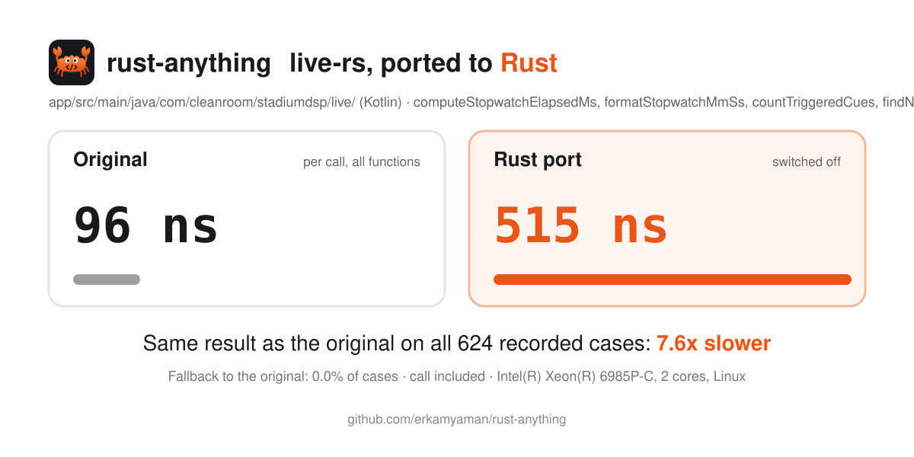

## `live-rs` in Rust

| | |
| --- | --- |
| Unit | `app/src/main/java/com/cleanroom/stadiumdsp/live/` (Kotlin) |
| Recorded cases matched | 624 / 624 |
| Speedup, call included | 0.1x (geometric mean) |
| Fallback to the original | 0.0% (0 of 624 cases) |
| Switched on | not switched by `enable` |

| Function | Cases | Original per call | Rust per call | Speedup |
| --- | ---: | ---: | ---: | ---: |
| `computeStopwatchElapsedMs` | 222 | 8 ns | 17 ns | 0.5x |
| `formatStopwatchMmSs` | 17 | 76 ns | 147 ns | 0.5x |
| `countTriggeredCues` | 191 | 6 ns | 172 ns | 0.0x |
| `findNextCueRemainingMs` | 194 | 6 ns | 179 ns | 0.0x |

Measured with `rust-anything report` on Intel(R) Xeon(R) 6985P-C, 2 cores, Linux: `diff` replays every recorded case, `bench` times them on both sides as callers call them. Reproduce: `rust-anything diff` and `rust-anything bench` in the crate folder.
